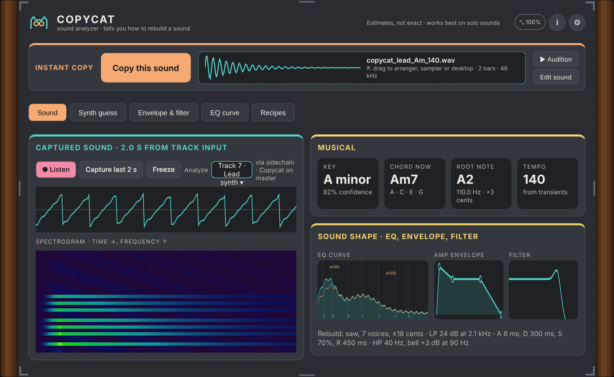

# Copycat 🐈

Sound analyser (VST3 and standalone): play a sound through it and it tells you the note, key, chord, tempo, oscillator shape, voices and detune, filter, envelope, and some EQ ideas, so you can rebuild the sound in your synth.

 Screenshot of the interactive mockup in docs/mockups.

**Manual:** [PDF, opens in the browser](https://github.com/SpeakingColors/copycat-vst/blob/main/docs/copycat-vst-manual.pdf)

## Status
Early. What exists today:
- A tested pure C++ analysis engine (`src/core`), ported from the [mockup](docs/mockup/): pitch, key, chord, tempo, ADSR, long term spectrum, filter cutoff and slope, oscillator guess, voice count and detune, EQ suggestions. The tests build their own synth sounds and check the answers.
- A JUCE plugin shell (`src/copycat`): audio passes through unchanged; a button analyses the last 2 seconds and prints the result as text.
- Not yet: the cat-ui editor (spectrogram, envelope and EQ views), the Rebuild synth that plays the copy, live analysis, presets. Cutoff and detune are rough estimates (the tests allow a factor of 2 on the cutoff). Nothing here has been tried on real recordings or in a host yet.

Run the engine tests: `sh tests/run.sh` (needs only g++).

  

☕ Free and open source, made by one person. If it helps your music, a coffee on [Ko-fi](https://ko-fi.com/studio87) keeps it coming. 💜

## Docs
- [Interactive mockups](docs/README.md)
- [Roadmap](ROADMAP.md)

## License
AGPL-3.0-or-later, see [LICENSE](LICENSE).

Not affiliated with or endorsed by any hardware maker named here. All trademarks belong to their owners.
